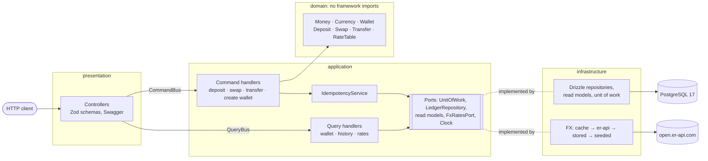
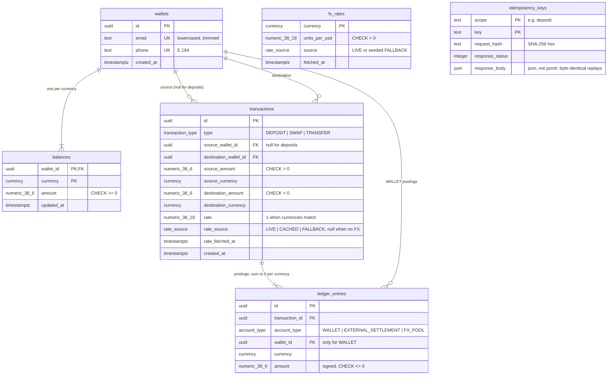

# Harmattan

**A stablecoin cross-border payment sandbox API.** Multi-currency wallets (cNGN, cGHS, cXAF, USDx,
EURx), simulated deposits, FX swaps, cross-currency transfers and transaction history, with exact
money math, exactly-once requests and concurrency safety enforced by the database.

> *Harmattan* is the dry trade wind that blows across West Africa every year, carrying dust from the
> Sahara over Nigeria, Ghana and Cameroon down to the Gulf of Guinea, ignoring borders on the way.
> Money should move the same way.

- [Quick start](#quick-start) · [Running tests](#running-tests) · [Tech stack](#tech-stack--why) ·
  [Architecture](#architecture) · [Endpoints](#endpoints) · [Walkthrough](#api-walkthrough) ·
  [Data model](#data-model) · [How it handles money, idempotency, concurrency and FX failures](#how-harmattan-handles)
  · [Assumptions and limitations](#assumptions)
- API docs: Swagger UI at `/docs` when running; the spec is committed as [`openapi.json`](openapi.json).
- Design decisions are recorded as ADRs in [`docs/DECISIONS.md`](docs/DECISIONS.md); the
  requirement-to-test traceability matrix is in [`docs/REQUIREMENTS.md`](docs/REQUIREMENTS.md).

## Quick start
```bash
docker compose up --build
# API:     http://localhost:3000/v1
# Swagger: http://localhost:3000/docs   (raw spec at /docs/openapi.json)
# Health:  http://localhost:3000/health
```
On start the API container applies migrations, seeds the fallback FX table, then starts (each step is
idempotent). Ports can be changed with `API_PORT` and `DB_PORT` (defaults 3000 and 5432), e.g.
`API_PORT=8080 docker compose up --build`.

### Local development
```bash
corepack enable && yarn install   # Yarn 4 via the packageManager field
cp .env.example .env
docker compose up -d db           # Postgres only
yarn db:migrate
yarn start:dev
```

## Running tests
```bash
corepack enable && yarn install
yarn test          # unit + e2e (requires Docker: Testcontainers starts Postgres 17)
yarn test:unit     # domain, handler and adapter tests, no Docker needed
yarn test:e2e      # HTTP tests against a real Postgres container
yarn lint && yarn format:check && yarn typecheck
```

- **e2e tests run against real Postgres**, never a mocked database: one container per run, migrated
  once, tables truncated between tests. They never reach the real FX provider (a fake `fetch` is
  injected; by default the network looks "down").
- **After every money test** a helper checks the double-entry invariants: each wallet balance equals
  the sum of its ledger postings, and each transaction's postings sum to zero per currency
  ([`test/helpers/ledger.ts`](test/helpers/ledger.ts)).
- **Concurrency and idempotency are tested with real parallel requests**: 50 debits against a
  balance that covers 10, opposite swaps and A→B ∥ B→A transfers, 10 identical requests with one
  `Idempotency-Key`, and a forced Postgres deadlock that must be retried.
- The critical guards were **mutation-checked**: removing the `amount >= x` debit condition, the lock
  ordering, the idempotency write, the exact rate parsing or the history cursor makes tests fail.
- `openapi.json` is regenerated with `yarn openapi`; an e2e test fails when it is out of date.

## Tech stack & why
| | Choice | Why |
|---|---|---|
| Runtime | Node 24 LTS, TypeScript (strict, `noUncheckedIndexedAccess`) | LTS with built-in `fetch` and `crypto.randomUUIDv7()`; strict types catch money/nullable mistakes at compile time |
| Framework | NestJS 12 + `@nestjs/cqrs` | DI and modules for clean boundaries; native Standard Schema validation; CQRS separates the strict write path from read models |
| Architecture | Clean Architecture + CQRS-lite ([ADR-010](docs/DECISIONS.md)) | Business rules live in a framework-free domain; money changes only through command handlers inside one unit of work |
| Database | PostgreSQL 17 ([ADR-002](docs/DECISIONS.md)) | See [Why PostgreSQL](#why-postgresql) |
| ORM / migrations | Drizzle + `drizzle-kit`, wired with `@nestjs/drizzle` ([ADR-003](docs/DECISIONS.md)) | SQL stays visible: conditional updates, `RETURNING`, row-value keyset pagination; reviewed SQL migrations |
| Money math | `decimal.js`, `numeric(38,6)` / `numeric(38,18)` ([ADR-007](docs/DECISIONS.md)) | Exact base-10 arithmetic; no JavaScript `number` ever touches an amount |
| Validation + API docs | Zod 4 via Standard Schema, `@nestjs/swagger` ([ADR-006](docs/DECISIONS.md)) | One schema validates the request and documents it in OpenAPI, no glue library |
| Health | `@nestjs/terminus` + a Drizzle indicator | Official Nest health checks: standard shape, 1 s DB timeout, 503 when down |
| FX | open.er-api.com via built-in `fetch` ([ADR-004](docs/DECISIONS.md)) | Free, keyless, USD-based, covers NGN/GHS/XAF/EUR; layered fallback when it fails |
| Tests | Vitest 5 + Supertest + Testcontainers | Fast unit tests; e2e on a real Postgres so constraints, locks and transactions are exercised |
| Tooling | Yarn 4, ESLint (typed, strict), Prettier, commitlint + husky | Conventional Commits; lint enforces layering (domain imports no framework) and explicit `await` |
| Cache / queue | None ([ADR-011](docs/DECISIONS.md)) | Money moves synchronously in one Postgres transaction; FX uses a 1 h in-memory cache with DB fallback. Redis/BullMQ would only earn their place with several replicas or background jobs |

### Why PostgreSQL
Payments need a database that enforces correctness, not one that leaves it to application code:

- **Multi-row ACID transactions.** A transfer changes two balances, writes a transaction row, four
  ledger postings and the idempotency record; all of it commits or none of it does.
- **Atomic conditional updates.** `UPDATE balances SET amount = amount - $x WHERE … AND amount >= $x
  RETURNING amount` debits without a read-modify-write race; no row back means insufficient funds.
- **Exact decimals.** `numeric(38,6)` stores money in base 10 with the scale enforced by the database.
- **Constraints as a backstop.** `CHECK (amount >= 0)` on balances, non-zero postings, positive
  amounts and rates, per-type transaction shape, unique email/phone and idempotency keys: even a bug
  in application code cannot write an invalid row.
- **Row locks and deadlock detection**, plus row-value comparisons for keyset pagination.

MongoDB would need a replica set for multi-document transactions and Decimal128 handling, and could
not express these invariants as constraints. MySQL 8 would work, but it has no `UPDATE … RETURNING`,
so the atomic debit would need a second query to read the new balance.

## Architecture


- **Dependency rule:** presentation → application → domain ← infrastructure. The domain imports no
  Nest, Drizzle or HTTP code; an ESLint rule fails the build if it does.
- **Commands** are the only way state changes. A handler validates with the domain, then runs inside
  `UnitOfWork.run(tx => …)`, one Postgres transaction that is retried once on deadlock (`40P01`) or
  serialization failure (`40001`).
- **Queries** read straight from Drizzle read models into response DTOs; they never load aggregates
  or take locks.
- Modules: `wallets`, `payments` (deposits, swaps, transfers, ledger), `fx`, `transactions`
  (history), and `shared` (money kernel, unit of work, idempotency, HTTP error envelope, config,
  health).

## Endpoints
| | Method and path | Purpose |
|---|---|---|
| E1 | `POST /v1/wallets` | Create a wallet with an email and/or phone (each unique) |
| E2 | `GET /v1/wallets/:walletId` | Balances, each with its USD value, and the total in USD |
| E3 | `POST /v1/wallets/:walletId/deposits` | Simulated deposit (requires `Idempotency-Key`) |
| E4 | `POST /v1/wallets/:walletId/swaps` | Convert between two currencies of one wallet (requires `Idempotency-Key`) |
| E5 | `POST /v1/transfers` | Send to another wallet, converting if the currencies differ (requires `Idempotency-Key`) |
| E6 | `GET /v1/wallets/:walletId/transactions` | History, newest first; `?type&currency&limit&cursor` |
| E7 | `GET /v1/transactions/:transactionId` | One transaction |
| E8 | `GET /v1/fx/rates` | All 25 currency pairs with `source` and `fetchedAt` |
| E9 | `GET /health` | API and database status |

**Conventions.** Amounts are decimal **strings** (`"1500.25"`); JSON numbers, exponents, more than 6
decimals and non-positive amounts are rejected. Responses always use 6 decimals (`"1500.250000"`),
rates 18. Ids are UUIDv7. Every error has the same shape:

```json
{ "error": { "code": "INSUFFICIENT_FUNDS", "message": "Insufficient USDx balance", "details": { "currency": "USDx", "amount": "1000.000000" } } }
```

| Status | Codes |
|---|---|
| 400 | `VALIDATION_ERROR` (with `details.issues[].path`), `BAD_REQUEST` (malformed JSON) |
| 404 | `WALLET_NOT_FOUND`, `TRANSACTION_NOT_FOUND`, `NOT_FOUND` |
| 409 | `WALLET_ALREADY_EXISTS` |
| 422 | `INSUFFICIENT_FUNDS`, `SAME_CURRENCY`, `SELF_TRANSFER`, `AMOUNT_TOO_SMALL`, `AMOUNT_LIMIT_EXCEEDED`, `IDEMPOTENCY_KEY_REUSED` |
| 500 / 503 | `INTERNAL_ERROR` (details never leaked), `SERVICE_UNAVAILABLE` (health) |

## API walkthrough
Real requests and responses, captured from `docker compose up` with live rates from the provider. Ids
and timestamps differ on every run; the arithmetic can be checked by hand (e.g. the swap below:
`50000 × 0.000742811320142640 = 37.14056600…`, rounded down to `37.140566`).

### Create a wallet
```bash
curl -s -X POST http://localhost:3000/v1/wallets \
  -H 'Content-Type: application/json' \
  -d '{"email": "Ada@Example.com", "phone": "0801 234 5678"}'
```
```http
HTTP 201
```
<details><summary>Response body</summary>

```json
{
  "id": "01a18a1a-0866-7f75-ad0b-429fbfe7b934",
  "email": "ada@example.com",
  "phone": "+2348012345678",
  "createdAt": "2026-10-29T23:58:44.326Z",
  "balances": [
    {
      "currency": "cNGN",
      "amount": "0.000000"
    },
    {
      "currency": "cGHS",
      "amount": "0.000000"
    },
    {
      "currency": "cXAF",
      "amount": "0.000000"
    },
    {
      "currency": "USDx",
      "amount": "0.000000"
    },
    {
      "currency": "EURx",
      "amount": "0.000000"
    }
  ]
}
```

</details>

### Create a second wallet
```bash
curl -s -X POST http://localhost:3000/v1/wallets \
  -H 'Content-Type: application/json' \
  -d '{"email": "bola@example.com"}'
```
```http
HTTP 201
```
<details><summary>Response body</summary>

```json
{
  "id": "01a18a1a-0870-71af-a945-990ab1edd032",
  "email": "bola@example.com",
  "phone": null,
  "createdAt": "2026-10-29T23:58:44.336Z",
  "balances": [
    {
      "currency": "cNGN",
      "amount": "0.000000"
    },
    {
      "currency": "cGHS",
      "amount": "0.000000"
    },
    {
      "currency": "cXAF",
      "amount": "0.000000"
    },
    {
      "currency": "USDx",
      "amount": "0.000000"
    },
    {
      "currency": "EURx",
      "amount": "0.000000"
    }
  ]
}
```

</details>

### Duplicate wallet (same phone, other format) → 409
```bash
curl -s -X POST http://localhost:3000/v1/wallets \
  -H 'Content-Type: application/json' \
  -d '{"phone": "+234 801 234 5678"}'
```
```http
HTTP 409
```
```json
{
  "error": {
    "code": "WALLET_ALREADY_EXISTS",
    "message": "A wallet with this phone already exists",
    "details": {
      "field": "phone"
    }
  }
}
```

### Deposit
```bash
curl -s -X POST http://localhost:3000/v1/wallets/01a18a1a-0866-7f75-ad0b-429fbfe7b934/deposits \
  -H 'Idempotency-Key: dep-ada-1' \
  -H 'Content-Type: application/json' \
  -d '{"currency": "cNGN", "amount": "150000"}'
```
```http
HTTP 201
```
<details><summary>Response body</summary>

```json
{
  "transaction": {
    "id": "01a18a1a-087f-7324-8834-1834a3b575dd",
    "type": "DEPOSIT",
    "sourceWalletId": null,
    "destinationWalletId": "01a18a1a-0866-7f75-ad0b-429fbfe7b934",
    "sourceAmount": "150000.000000",
    "sourceCurrency": "cNGN",
    "destinationAmount": "150000.000000",
    "destinationCurrency": "cNGN",
    "rate": "1.000000000000000000",
    "rateSource": null,
    "rateFetchedAt": null,
    "createdAt": "2026-10-29T23:58:44.351Z"
  },
  "balance": {
    "currency": "cNGN",
    "amount": "150000.000000"
  }
}
```

</details>

### Same request again → replayed, money moved once
```bash
curl -s -X POST http://localhost:3000/v1/wallets/01a18a1a-0866-7f75-ad0b-429fbfe7b934/deposits \
  -H 'Idempotency-Key: dep-ada-1' \
  -H 'Content-Type: application/json' \
  -d '{"currency": "cNGN", "amount": "150000"}'
```
```http
HTTP 201
Idempotent-Replayed: true
```
<details><summary>Response body</summary>

```json
{
  "transaction": {
    "id": "01a18a1a-087f-7324-8834-1834a3b575dd",
    "type": "DEPOSIT",
    "sourceWalletId": null,
    "destinationWalletId": "01a18a1a-0866-7f75-ad0b-429fbfe7b934",
    "sourceAmount": "150000.000000",
    "sourceCurrency": "cNGN",
    "destinationAmount": "150000.000000",
    "destinationCurrency": "cNGN",
    "rate": "1.000000000000000000",
    "rateSource": null,
    "rateFetchedAt": null,
    "createdAt": "2026-10-29T23:58:44.351Z"
  },
  "balance": {
    "currency": "cNGN",
    "amount": "150000.000000"
  }
}
```

</details>

### Same key, different body → 422
```bash
curl -s -X POST http://localhost:3000/v1/wallets/01a18a1a-0866-7f75-ad0b-429fbfe7b934/deposits \
  -H 'Idempotency-Key: dep-ada-1' \
  -H 'Content-Type: application/json' \
  -d '{"currency": "cNGN", "amount": "999"}'
```
```http
HTTP 422
```
```json
{
  "error": {
    "code": "IDEMPOTENCY_KEY_REUSED",
    "message": "This Idempotency-Key was already used with a different request",
    "details": {
      "key": "dep-ada-1"
    }
  }
}
```

### Swap
```bash
curl -s -X POST http://localhost:3000/v1/wallets/01a18a1a-0866-7f75-ad0b-429fbfe7b934/swaps \
  -H 'Idempotency-Key: swap-ada-1' \
  -H 'Content-Type: application/json' \
  -d '{"fromCurrency": "cNGN", "toCurrency": "USDx", "amount": "50000"}'
```
```http
HTTP 201
```
<details><summary>Response body</summary>

```json
{
  "transaction": {
    "id": "01a18a1a-0add-7368-89c3-a2661b204e79",
    "type": "SWAP",
    "sourceWalletId": "01a18a1a-0866-7f75-ad0b-429fbfe7b934",
    "destinationWalletId": "01a18a1a-0866-7f75-ad0b-429fbfe7b934",
    "sourceAmount": "50000.000000",
    "sourceCurrency": "cNGN",
    "destinationAmount": "37.140566",
    "destinationCurrency": "USDx",
    "rate": "0.000742811320142640",
    "rateSource": "LIVE",
    "rateFetchedAt": "2026-10-29T00:02:31.000Z",
    "createdAt": "2026-10-29T23:58:44.957Z"
  },
  "balances": [
    {
      "currency": "cNGN",
      "amount": "100000.000000"
    },
    {
      "currency": "USDx",
      "amount": "37.140566"
    }
  ]
}
```

</details>

### Swap more than the balance → 422, nothing changes
```bash
curl -s -X POST http://localhost:3000/v1/wallets/01a18a1a-0866-7f75-ad0b-429fbfe7b934/swaps \
  -H 'Idempotency-Key: swap-ada-2' \
  -H 'Content-Type: application/json' \
  -d '{"fromCurrency": "USDx", "toCurrency": "EURx", "amount": "1000"}'
```
```http
HTTP 422
```
```json
{
  "error": {
    "code": "INSUFFICIENT_FUNDS",
    "message": "Insufficient USDx balance",
    "details": {
      "currency": "USDx",
      "amount": "1000.000000"
    }
  }
}
```

### Cross-currency transfer
```bash
curl -s -X POST http://localhost:3000/v1/transfers \
  -H 'Idempotency-Key: xfer-ada-1' \
  -H 'Content-Type: application/json' \
  -d '{"fromWalletId": "01a18a1a-0866-7f75-ad0b-429fbfe7b934", "toWalletId": "01a18a1a-0870-71af-a945-990ab1edd032", "sourceCurrency": "cNGN", "destinationCurrency": "cGHS", "amount": "20000"}'
```
```http
HTTP 201
```
<details><summary>Response body</summary>

```json
{
  "transaction": {
    "id": "01a18a1a-0aec-7aa7-8427-72e132502aa1",
    "type": "TRANSFER",
    "sourceWalletId": "01a18a1a-0866-7f75-ad0b-429fbfe7b934",
    "destinationWalletId": "01a18a1a-0870-71af-a945-990ab1edd032",
    "sourceAmount": "20000.000000",
    "sourceCurrency": "cNGN",
    "destinationAmount": "172.925227",
    "destinationCurrency": "cGHS",
    "rate": "0.008646261370309442",
    "rateSource": "LIVE",
    "rateFetchedAt": "2026-10-29T00:02:31.000Z",
    "createdAt": "2026-10-29T23:58:44.972Z"
  },
  "senderBalance": {
    "currency": "cNGN",
    "amount": "80000.000000"
  }
}
```

</details>

### Same-currency transfer
```bash
curl -s -X POST http://localhost:3000/v1/transfers \
  -H 'Idempotency-Key: xfer-ada-2' \
  -H 'Content-Type: application/json' \
  -d '{"fromWalletId": "01a18a1a-0866-7f75-ad0b-429fbfe7b934", "toWalletId": "01a18a1a-0870-71af-a945-990ab1edd032", "sourceCurrency": "USDx", "destinationCurrency": "USDx", "amount": "5"}'
```
```http
HTTP 201
```
<details><summary>Response body</summary>

```json
{
  "transaction": {
    "id": "01a18a1a-0af4-77dc-ab1f-aab7e402389f",
    "type": "TRANSFER",
    "sourceWalletId": "01a18a1a-0866-7f75-ad0b-429fbfe7b934",
    "destinationWalletId": "01a18a1a-0870-71af-a945-990ab1edd032",
    "sourceAmount": "5.000000",
    "sourceCurrency": "USDx",
    "destinationAmount": "5.000000",
    "destinationCurrency": "USDx",
    "rate": "1.000000000000000000",
    "rateSource": null,
    "rateFetchedAt": null,
    "createdAt": "2026-10-29T23:58:44.980Z"
  },
  "senderBalance": {
    "currency": "USDx",
    "amount": "32.140566"
  }
}
```

</details>

### Get a wallet: balances and total in USD
```bash
curl -s -X GET http://localhost:3000/v1/wallets/01a18a1a-0866-7f75-ad0b-429fbfe7b934
```
```http
HTTP 200
```
<details><summary>Response body</summary>

```json
{
  "id": "01a18a1a-0866-7f75-ad0b-429fbfe7b934",
  "email": "ada@example.com",
  "phone": "+2348012345678",
  "createdAt": "2026-10-29T23:58:44.326Z",
  "balances": [
    {
      "currency": "cNGN",
      "amount": "80000.000000",
      "usdValue": "59.424905"
    },
    {
      "currency": "cGHS",
      "amount": "0.000000",
      "usdValue": "0.000000"
    },
    {
      "currency": "cXAF",
      "amount": "0.000000",
      "usdValue": "0.000000"
    },
    {
      "currency": "USDx",
      "amount": "32.140566",
      "usdValue": "32.140566"
    },
    {
      "currency": "EURx",
      "amount": "0.000000",
      "usdValue": "0.000000"
    }
  ],
  "totalUsd": "91.565471",
  "ratesAsOf": "2026-10-29T00:02:31.000Z",
  "ratesSource": "LIVE"
}
```

</details>

### Transaction history (newest first, 2 per page)
```bash
curl -s -X GET http://localhost:3000/v1/wallets/01a18a1a-0866-7f75-ad0b-429fbfe7b934/transactions?limit=2
```
```http
HTTP 200
```
<details><summary>Response body</summary>

```json
{
  "items": [
    {
      "id": "01a18a1a-0af4-77dc-ab1f-aab7e402389f",
      "type": "TRANSFER",
      "sourceWalletId": "01a18a1a-0866-7f75-ad0b-429fbfe7b934",
      "destinationWalletId": "01a18a1a-0870-71af-a945-990ab1edd032",
      "sourceAmount": "5.000000",
      "sourceCurrency": "USDx",
      "destinationAmount": "5.000000",
      "destinationCurrency": "USDx",
      "rate": "1.000000000000000000",
      "rateSource": null,
      "rateFetchedAt": null,
      "createdAt": "2026-10-29T23:58:44.980Z",
      "entryType": "TRANSFER_OUT"
    },
    {
      "id": "01a18a1a-0aec-7aa7-8427-72e132502aa1",
      "type": "TRANSFER",
      "sourceWalletId": "01a18a1a-0866-7f75-ad0b-429fbfe7b934",
      "destinationWalletId": "01a18a1a-0870-71af-a945-990ab1edd032",
      "sourceAmount": "20000.000000",
      "sourceCurrency": "cNGN",
      "destinationAmount": "172.925227",
      "destinationCurrency": "cGHS",
      "rate": "0.008646261370309442",
      "rateSource": "LIVE",
      "rateFetchedAt": "2026-10-29T00:02:31.000Z",
      "createdAt": "2026-10-29T23:58:44.972Z",
      "entryType": "TRANSFER_OUT"
    }
  ],
  "nextCursor": "MjAyNi0xMC0yOVQyMzo1ODo0NC45NzJafDAxYTE4YTFhLTBhZWMtN2FhNy04NDI3LTcyZTEzMjUwMmFhMQ"
}
```

</details>

### Next page
```bash
curl -s -X GET http://localhost:3000/v1/wallets/01a18a1a-0866-7f75-ad0b-429fbfe7b934/transactions?limit=2&cursor=MjAyNi0xMC0yOVQyMzo1ODo0NC45NzJafDAxYTE4YTFhLTBhZWMtN2FhNy04NDI3LTcyZTEzMjUwMmFhMQ
```
```http
HTTP 200
```
<details><summary>Response body</summary>

```json
{
  "items": [
    {
      "id": "01a18a1a-0add-7368-89c3-a2661b204e79",
      "type": "SWAP",
      "sourceWalletId": "01a18a1a-0866-7f75-ad0b-429fbfe7b934",
      "destinationWalletId": "01a18a1a-0866-7f75-ad0b-429fbfe7b934",
      "sourceAmount": "50000.000000",
      "sourceCurrency": "cNGN",
      "destinationAmount": "37.140566",
      "destinationCurrency": "USDx",
      "rate": "0.000742811320142640",
      "rateSource": "LIVE",
      "rateFetchedAt": "2026-10-29T00:02:31.000Z",
      "createdAt": "2026-10-29T23:58:44.957Z",
      "entryType": "SWAP"
    },
    {
      "id": "01a18a1a-087f-7324-8834-1834a3b575dd",
      "type": "DEPOSIT",
      "sourceWalletId": null,
      "destinationWalletId": "01a18a1a-0866-7f75-ad0b-429fbfe7b934",
      "sourceAmount": "150000.000000",
      "sourceCurrency": "cNGN",
      "destinationAmount": "150000.000000",
      "destinationCurrency": "cNGN",
      "rate": "1.000000000000000000",
      "rateSource": null,
      "rateFetchedAt": null,
      "createdAt": "2026-10-29T23:58:44.351Z",
      "entryType": "DEPOSIT"
    }
  ],
  "nextCursor": null
}
```

</details>

### Filtered: the receiver's incoming transfers
```bash
curl -s -X GET http://localhost:3000/v1/wallets/01a18a1a-0870-71af-a945-990ab1edd032/transactions?type=TRANSFER_IN&currency=cGHS
```
```http
HTTP 200
```
<details><summary>Response body</summary>

```json
{
  "items": [
    {
      "id": "01a18a1a-0aec-7aa7-8427-72e132502aa1",
      "type": "TRANSFER",
      "sourceWalletId": "01a18a1a-0866-7f75-ad0b-429fbfe7b934",
      "destinationWalletId": "01a18a1a-0870-71af-a945-990ab1edd032",
      "sourceAmount": "20000.000000",
      "sourceCurrency": "cNGN",
      "destinationAmount": "172.925227",
      "destinationCurrency": "cGHS",
      "rate": "0.008646261370309442",
      "rateSource": "LIVE",
      "rateFetchedAt": "2026-10-29T00:02:31.000Z",
      "createdAt": "2026-10-29T23:58:44.972Z",
      "entryType": "TRANSFER_IN"
    }
  ],
  "nextCursor": null
}
```

</details>

### Get one transaction
```bash
curl -s -X GET http://localhost:3000/v1/transactions/01a18a1a-0aec-7aa7-8427-72e132502aa1
```
```http
HTTP 200
```
<details><summary>Response body</summary>

```json
{
  "id": "01a18a1a-0aec-7aa7-8427-72e132502aa1",
  "type": "TRANSFER",
  "sourceWalletId": "01a18a1a-0866-7f75-ad0b-429fbfe7b934",
  "destinationWalletId": "01a18a1a-0870-71af-a945-990ab1edd032",
  "sourceAmount": "20000.000000",
  "sourceCurrency": "cNGN",
  "destinationAmount": "172.925227",
  "destinationCurrency": "cGHS",
  "rate": "0.008646261370309442",
  "rateSource": "LIVE",
  "rateFetchedAt": "2026-10-29T00:02:31.000Z",
  "createdAt": "2026-10-29T23:58:44.972Z"
}
```

</details>

### FX rates (5×5 matrix; first 3 of 25 pairs shown)
```bash
curl -s -X GET http://localhost:3000/v1/fx/rates
```
```http
HTTP 200
```
<details><summary>Response body</summary>

```json
{
  "source": "LIVE",
  "fetchedAt": "2026-10-29T00:02:31.000Z",
  "attribution": {
    "text": "Rates By Exchange Rate API",
    "url": "https://www.exchangerate-api.com"
  },
  "rates": [
    {
      "from": "cNGN",
      "to": "cNGN",
      "rate": "1.000000000000000000",
      "source": "LIVE",
      "fetchedAt": "2026-10-29T00:02:31.000Z"
    },
    {
      "from": "cNGN",
      "to": "cGHS",
      "rate": "0.008646261370309442",
      "source": "LIVE",
      "fetchedAt": "2026-10-29T00:02:31.000Z"
    },
    {
      "from": "cNGN",
      "to": "cXAF",
      "rate": "0.437166062857133654",
      "source": "LIVE",
      "fetchedAt": "2026-10-29T00:02:31.000Z"
    },
    "\u2026 22 more pairs"
  ]
}
```

</details>

### Validation error → 400
```bash
curl -s -X POST http://localhost:3000/v1/wallets/01a18a1a-0866-7f75-ad0b-429fbfe7b934/deposits \
  -H 'Idempotency-Key: bad-1' \
  -H 'Content-Type: application/json' \
  -d '{"currency": "cNGN", "amount": 1500.25}'
```
```http
HTTP 400
```
<details><summary>Response body</summary>

```json
{
  "error": {
    "code": "VALIDATION_ERROR",
    "message": "Request validation failed",
    "details": {
      "issues": [
        {
          "path": "amount",
          "message": "Invalid input: expected string, received number"
        }
      ]
    }
  }
}
```

</details>

### Health
```bash
curl -s -X GET http://localhost:3000/health
```
```http
HTTP 200
```
<details><summary>Response body</summary>

```json
{
  "status": "ok",
  "info": {
    "database": {
      "responseTime": 0,
      "status": "up"
    }
  },
  "error": {},
  "details": {
    "database": {
      "responseTime": 0,
      "status": "up"
    }
  }
}
```

</details>

## Data model


- **`balances`** is the fast, materialized balance per wallet and currency (all five rows are created
  with the wallet). **`ledger_entries`** is the double-entry audit trail behind it ([ADR-008](docs/DECISIONS.md)).
- **System accounts are not rows.** A posting names its account as `(account_type, wallet_id,
  currency)`: the counterparty of a deposit is `EXTERNAL_SETTLEMENT`, and conversions go through a
  `FX_POOL` per currency, so every transaction nets to zero per currency. Example, swap 1000 cNGN →
  0.625 USDx: wallet cNGN −1000, FX_POOL cNGN +1000, FX_POOL USDx −0.625, wallet USDx +0.625.
- **Constraints back up the application:** non-negative balances, positive amounts and rates,
  non-zero postings, a CHECK per transaction type (a deposit has no sender and keeps currency and
  amount; a swap stays in one wallet and changes currency; a transfer joins two different wallets),
  FX fields present exactly when currencies differ, normalized email and E.164 phone, key formats.
- **Indexes:** `(source_wallet_id | destination_wallet_id, created_at DESC, id DESC)` for history,
  unique email and phone, ledger lookups by transaction and by wallet/currency. All timestamps are
  millisecond precision so history cursors round-trip exactly.
- Schema: [`src/shared/infrastructure/database/schema/`](src/shared/infrastructure/database/schema/);
  migrations: [`…/migrations/`](src/shared/infrastructure/database/migrations/).

## How Harmattan handles…
### Money precision
- Amounts travel as **decimal strings** and are parsed by [`Money`](src/shared/domain/money.ts):
  plain decimals only, at most 6 decimal places, at most 32 integer digits (the range of
  `numeric(38,6)`). Input that does not fit is **rejected, never rounded**.
- Arithmetic uses `decimal.js` with a private configuration (100 significant digits, round down);
  storage is `numeric(38,6)` for amounts and `numeric(38,18)` for rates; responses use 6 decimals.
- **Conversion:** `destination = roundDown(amount × rate, 6)` with the 18-decimal rate, which is stored
  on the transaction with its source and refresh time. The rounding remainder stays in the FX pool,
  never in the user's favour by accident. A conversion that would round to zero is rejected
  (`AMOUNT_TOO_SMALL`) instead of taking the money.
- **Valuation** (wallet `usdValue`, `totalUsd`) moves no money, so it divides exactly
  (`amount ÷ units per USD`, rounded down once): 9 EURx at 0.9 per USD shows `10.000000`, not the
  `9.999999` a truncated cross rate would give.
- FX rates arrive from the provider as JSON numbers; they are read from the **exact JSON source
  text**, so they never pass through a binary float.

### Idempotency
- `POST` deposits, swaps and transfers **require** an `Idempotency-Key` header (1-255 visible ASCII
  characters, e.g. a UUID); keys are scoped to the wallet (the sender, for transfers).
- The key, a SHA-256 hash of the normalized request and the full response are stored **in the same
  database transaction as the money movement** ([ADR-005](docs/DECISIONS.md),
  [`IdempotencyService`](src/shared/application/idempotency.service.ts)):
  - same key and body again → the stored response is returned byte for byte, with
    `Idempotent-Replayed: true`, and no money moves;
  - same key with a different body → `422 IDEMPOTENCY_KEY_REUSED`;
  - two identical requests at the same time → both insert the key; the loser hits the primary key,
    its whole transaction (including the money movement) rolls back, and it returns the winner's
    response. Tested with 10 parallel identical requests: one movement, ten identical bodies.
- A request that fails (e.g. insufficient funds) stores nothing, so the same key can be retried after
  the problem is fixed.

### Concurrency
- **No negative balance, ever:** a debit is one atomic conditional update (`… WHERE amount >= $x
  RETURNING`); an empty result means `INSUFFICIENT_FUNDS`. There is no read-then-write window, and
  `CHECK (amount >= 0)` backs it up. Tested: 50 parallel 1 USDx swaps against a 10 USDx balance let
  exactly 10 through and leave 0.
- **No deadlocks from lock order:** every operation updates its balance rows in one global order,
  sorted by (wallet id, currency). Tested: opposite swaps on one wallet and A→B ∥ B→A transfers, all
  succeed with totals conserved. Without the ordering, Postgres reports real deadlocks.
- **Anything left over is retried:** the unit of work retries the whole transaction once on `40P01`
  (deadlock) or `40001` (serialization failure); a test provokes a real deadlock to prove it.
- FX rates are fetched **before** the transaction opens, so a slow provider never holds a database
  connection or row locks.

### FX rate failures
Rates come from [open.er-api.com](https://www.exchangerate-api.com) (USD base, refreshed by the
provider once a day). Each stablecoin is pegged 1:1 to its fiat currency (cNGN→NGN, cGHS→GHS,
cXAF→XAF, USDx→USD, EURx→EUR); a cross rate is `perUsd[B] / perUsd[A]`. The chain
([`FxRatesService`](src/modules/fx/application/fx-rates.service.ts), [ADR-004](docs/DECISIONS.md)):

1. **In-memory cache**, 1 hour or until the provider's next refresh if sooner (the provider asks
   clients to call at most about hourly). Concurrent requests share one refresh.
2. **Live provider**, 2 s timeout → `source: LIVE`. Failures include timeouts, HTTP errors and 429,
   malformed JSON, and the provider's error bodies (sent with HTTP 200 and `result: "error"`).
   Successful rates are saved to `fx_rates`.
3. **Last good live rates** from the database → `source: CACHED`.
4. **Seeded fallback table** (written at container start, and built into the code for an empty
   database) → `source: FALLBACK`.

A failure is cached for 5 minutes so a down provider is not called on every request. Every
response that uses rates says which ones: `source`/`fetchedAt` on `GET /v1/fx/rates`,
`ratesSource`/`ratesAsOf` on a wallet, `rateSource`/`rateFetchedAt` on each transaction.

## Assumptions
- **No authentication or KYC**: any client can act on any wallet id (sandbox). A transfer response
  shows only the sender's balance.
- A wallet is identified by an email, a phone number or both, each unique. Emails are trimmed and
  lowercased; phones are stored in E.164, and numbers without a country code are read as Nigerian.
- Deposits are simulated (no funding source) and capped at 1,000,000,000,000 per request.
- All five currencies use 6 decimal places; stablecoins are pegged 1:1 to their fiat currency.
- `amount` is always what leaves the source: a swap or transfer debits exactly `amount` and the
  receiver gets the converted, rounded-down value. Same-currency transfers use rate 1.
- A wallet cannot transfer to itself (`SELF_TRANSFER`); use a swap to change currency.
- No fees or spreads.
- Idempotency keys are kept indefinitely; failed requests do not consume a key.

## Known limitations
- FX: the free provider refreshes rates once a day, so rates are at most about 24 h old even when
  `source` is `LIVE`. The built-in fallback table (used only if the provider has never been reached)
  is a snapshot from 2026-10-29 and drifts from the market.
- FX: the rates cache is per process (single instance assumed, ADR-011); several replicas would each
  call the provider (still within its hourly guidance).
- The rate is read just before the transaction, without a quote: two requests a moment apart can get
  different rates if the provider refreshed in between, and clients cannot lock a rate in advance.
- History matches `source_wallet_id = w OR destination_wallet_id = w`, which is fine at sandbox scale
  but not optimal for very large histories (see below).
- No withdrawals, no limits per wallet or per day, no rate limiting on the API.

## What I'd do with more time
- **FX quotes**: `POST /v1/fx/quotes` returning a `quoteId` with an expiry that a swap or transfer can
  reference, so the client sees and locks the rate before money moves.
- History query: replace `source_wallet_id = w OR destination_wallet_id = w` with a `UNION ALL` of the
  two indexed branches so each uses its index for ordering at large volumes.
- Structured JSON logs with a request id, and metrics on rate source, retries and 4xx/5xx.
- Rate limiting on money endpoints, and an expiry policy for idempotency keys.
- CI pipeline (lint, typecheck, tests) on every push.
- Authentication, so wallets belong to users.

## Credits
Exchange rates: [Rates By Exchange Rate API](https://www.exchangerate-api.com) (open.er-api.com free
endpoint; attribution required by its terms).
